# Plan Upgrade and Downgrade Semantics

Subscribers move an open mandate onto another plan of the same merchant and
token through `Subscription::upgrade(subscriber, mandate_id, new_plan_id)`
([`contracts/subscription/src/lib.rs`](../contracts/subscription/src/lib.rs)).
This single entry point handles both **upgrades** (moving to a higher-priced
plan) and **downgrades** (moving to a lower-priced plan), as well as billing
period changes.

For worked integer examples, see [ADR 0006: Prorated upgrade
charging](adr/0006-prorated-upgrade-charging.md).

## State diagram

```mermaid
stateDiagram-v2
    [*] --> ValidateCaller: "upgrade(subscriber, mandate_id, new_plan_id)"

    ValidateCaller --> Rejected: "ProtocolPaused / MandateNotFound / NotSubscriber"
    ValidateCaller --> CheckMandateState: "subscriber.require_auth() OK"

    CheckMandateState --> Rejected: "Cancelled / Completed / Paused (indefinite or future)"
    CheckMandateState --> ValidateTargetPlan: "Active or scheduled pause elapsed (active_at)"

    ValidateTargetPlan --> Rejected: "PlanNotFound / PlanInactive / PlanChargesPaused"
    ValidateTargetPlan --> Rejected: "DifferentToken / DifferentMerchant / PlanFull"
    ValidateTargetPlan --> ComputeProration: "Valid same-merchant, same-token active plan"

    ComputeProration --> UpgradeDebit: "difference > 0 and charged > 0"
    ComputeProration --> ApplyTermsOnly: "difference <= 0 (downgrade/same price) or charged == 0"

    UpgradeDebit --> Rejected: "VaultCallFailed (insufficient balance+reserve or spend limit)"
    UpgradeDebit --> ApplyTermsOnly: "debit_split_mandate succeeds (merchant_gross + fee)"

    ApplyTermsOnly --> Done: "Update plan_id, amount, period, keeper_bps; swap seat if plan changed"
    Done --> [*]: "Emit MandateUpdated, Upgraded, CommittedRevenueChanged"
    Rejected --> [*]: "Transaction reverts; mandate & vault unchanged"
```



## Eligibility and preconditions

Before any state is written or funds move, `upgrade` verifies:

1. **Authorization & pause state:** `subscriber.require_auth()` passes and the
   protocol is not paused (`Error::ProtocolPaused`).
2. **Mandate ownership & status:** `mandate.subscriber == subscriber`
   (`Error::NotSubscriber`), and `lifecycle::active_at(&mandate, now)` is
   `true` (`Error::MandateNotActive` otherwise). A mandate with a scheduled
   `pause_until` that has already elapsed (`now >= paused_until`) counts as
   active; an indefinite pause (`paused_until == 0`), an active future pause,
   `Cancelled`, and `Completed` are rejected.
3. **Target plan validity:**
   - Plan exists and `plan.active == true` (`Error::PlanNotFound`,
     `Error::PlanInactive`).
   - `plan.token == mandate.token` (`Error::DifferentToken`).
   - `plan.merchant == mandate.merchant` (`Error::DifferentMerchant`).
   - Plan charging is not paused (`Error::PlanChargesPaused`).
   - If `new_plan_id != old_plan_id` and `plan.max_subscribers != 0`, the
     target plan has an open seat (`Error::PlanFull`).

## Upgrade mid-period proration

When moving to a more expensive plan (`plan.amount > old_amount`), the
subscriber pays the price difference for the remainder of the current billing
cycle immediately:

```text
remaining = mandate.next_charge.saturating_sub(now).min(old_period)
difference = plan.amount - old_amount
charged    = difference * remaining / old_period        // integer division, truncated toward zero
```

### Fee split and settlement

When `charged > 0`:

- **Protocol fee:** `fee = charged * mandate.fee_bps / BPS_DENOMINATOR`, using
  the `fee_bps` frozen into the mandate at subscribe time.
- **Merchant gross:** `merchant_gross = charged - fee`.
- **Keeper tip:** **None.** No `charge` was settled, so `keeper_bps` is not
  paid on an upgrade.
- **Vault debit:** `Subscription` calls `vault.debit_split_mandate(subscriber,
  mandate.token, mandate_id, mandate.merchant, merchant_gross, fee_to, fee)`.
  Just like a regular mandate charge, this draws from the mandate's own vault
  reserve first before touching `unreserved_balance`, and counts against any
  per-window `SpendLimit`.

### Edge cases in proration

- **Before the first charge (`now >= next_charge`):** `remaining` is `0`, so
  `charged = 0`. No proration is collected because the old price was never
  billed yet; the new price applies to the upcoming charge.
- **At or past the period boundary:** `remaining == 0`, so `charged = 0`.
- **Truncation below 1 unit:** If `difference * remaining < old_period`,
  integer division yields `0` (always rounding in the subscriber's favour). No
  vault call is made.
- **Period length change:** Proration uses `old_period` for the remainder of the
  current cycle. `mandate.next_charge` is **not** moved; `plan.period` governs
  future cycles scheduled after the next `charge`.
- **Refund ceiling:** `upgrade` does not increment `charges_made` or
  `total_spent`, so prorated upgrade payments are not included in the on-chain
  `refund` ceiling (`merchant_received`).

## Downgrade semantics and excess reserved balance

When `plan.amount <= old_amount` (`difference <= 0`):

- **No charge and no refund:** `charged` is `0`. No vault debit occurs, and
  nothing is refunded for the remainder of the current period already paid at
  the higher rate.
- **Effective date:** `next_charge` stays unchanged; the lower `mandate.amount`
  (and any new `mandate.period`) takes effect starting at the next scheduled
  `charge`.
- **Excess reserved balance in the Vault:**
  - `Subscription::upgrade` does **not** touch `Vault::set_reserve` on a
    downgrade—`Vault` has no knowledge of plan prices.
  - Any reserve previously earmarked for `mandate_id` (for instance, `old_amount`)
    remains stored under `DataKey::Reserved(subscriber, token, mandate_id)`.
  - The excess amount (`old_reserve - new_amount`) stays earmarked and cannot
    be withdrawn via `withdraw` / `withdraw_all` or spent by other mandates
    until either:
    1. **The subscriber reduces or releases it manually** with
       `vault.set_reserve(subscriber, token, mandate_id, new_amount)` (or `0` to
       release completely). Reducing a reserve is always allowed, even if the
       vault's `reserve_cap_bps` would block new reservations.
    2. **Subsequent `charge` calls draw it down:** each `charge` consumes
       `min(reserved, new_amount)` from the reserve first, so the excess
       gradually pays future periods until depleted.

See [Vault Reserve Lifecycle](vault-reserves.md) for the complete reserve state
table.

## Fields updated vs. frozen on `upgrade`

| Field | Behaviour on `upgrade` |
|---|---|
| `plan_id`, `amount`, `period` | Updated to the target plan's values |
| `keeper_bps` | Updated to `plan.keeper_bps.min(MAX_KEEPER_BPS)` |
| `next_charge` | **Unchanged** (billing date never shifts) |
| `fee_bps` | **Frozen** (keeps the rate from initial `subscribe`) |
| `payout`, `referrer`, `referral_bps` | **Frozen** (keeps the values from initial `subscribe`) |
| `charges_made`, `total_spent`, `refunded` | **Unchanged** |
| `max_charges`, `max_total`, `seats`, `max_pause_secs`, grace period | **Unchanged** |
| Plan open-seat count (`PlanSubscriberCount`) | Decremented on `old_plan_id`, incremented on `new_plan_id` (if plan IDs differ) |
