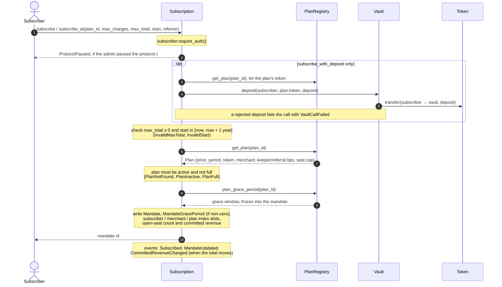
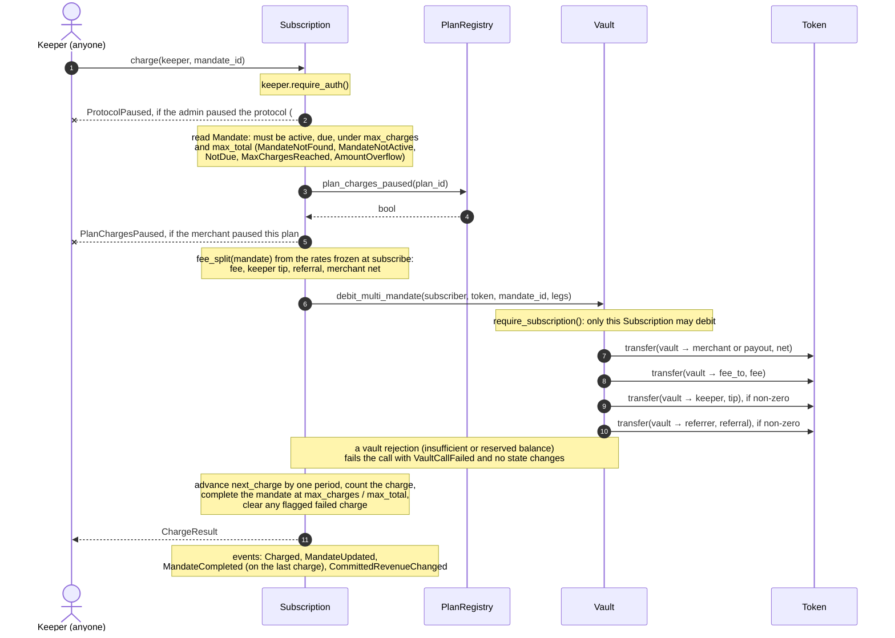
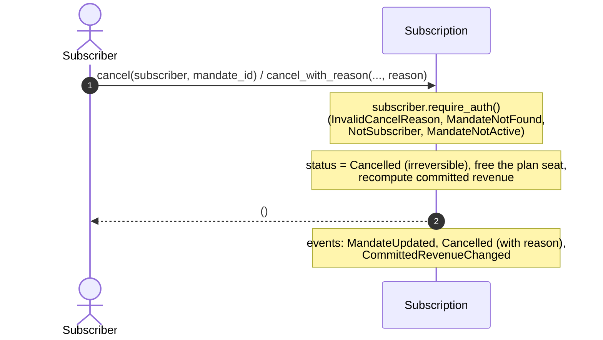

# Sequence diagrams: subscribe, charge and cancel

These diagrams show which contract calls which for Payflow's three core flows,
in the order the calls happen. They are drawn from the v0.2.0 sources plus the
protocol pause (#285) and are kept short on purpose: storage writes are grouped
into one step, and only cross-contract calls and events are spelled out. Where a
flow can stop early, the error is named on the arrow so it can be found in
`contracts/subscription/src/error.rs`.

The three contracts:

- **Subscription** (`contracts/subscription`): the billing engine. Owns
  mandates, the per-subscriber, per-merchant and per-plan indexes, and the
  protocol pause.
- **PlanRegistry** (`contracts/plan-registry`): merchants' plans. Subscription
  only ever reads from it, through `PlanRegistryClient` in
  [`interfaces.rs`](../contracts/subscription/src/interfaces.rs).
- **Vault** (`contracts/vault`): subscribers' balances. Only the configured
  Subscription contract may debit it (`require_subscription`), and it is the
  only contract that moves tokens on a charge. See
  [ADR 0001](adr/0001-vault-separate-from-billing.md).

GitHub renders the `mermaid` blocks below. Elsewhere, paste a block into
<https://mermaid.live>.

## Subscribe

`subscribe` is `subscribe_at(..., now)`. `subscribe_with_deposit` adds a vault
deposit before the same core (`do_subscribe_at`), under the subscriber's single
authorization.

No money moves on subscribe (unless `subscribe_with_deposit` deposits). The
first charge is due at `start`.

## Charge

`charge` is permissionless ([ADR 0005](adr/0005-permissionless-charge.md)): any
keeper may call it once a mandate is due. The vault, not the keeper, is the
one that pays every leg.

If the vault cannot cover a due charge, anyone may call `flag_failed_charge`,
which asks the vault `can_debit` and records the failure without moving money.

## Cancel

Cancelling stays within the Subscription contract: it makes no calls to the
registry or the vault, so it keeps working whatever state those contracts are
in, and while the protocol is paused.

The subscriber's vault balance is untouched by a cancel. They take it out with
the vault's `withdraw`, `withdraw_to` or `withdraw_all`, which never consult the
Subscription contract or its pause switch.

## During a protocol pause

When the admin calls `set_protocol_paused(true)`:

| Flow | Behaviour |
|---|---|
| `subscribe`, `subscribe_with_id`, `subscribe_at`, `subscribe_with_deposit` | Fail with `ProtocolPaused` before any call to the registry or the vault |
| `charge` | Fails with `ProtocolPaused`; the mandate's `next_charge` is unchanged, so it is chargeable as soon as the protocol resumes |
| `upgrade` | Fails with `ProtocolPaused` |
| `cancel`, `cancel_page`, `end_mandate`, `delete_mandate`, `set_paused`, `pause_until`, `refund` | Unaffected |
| Every view, `extend_merchant_mandates_ttl` | Unaffected |
| Vault `withdraw`, `withdraw_to`, `withdraw_all` | Unaffected: the vault never reads the switch |
