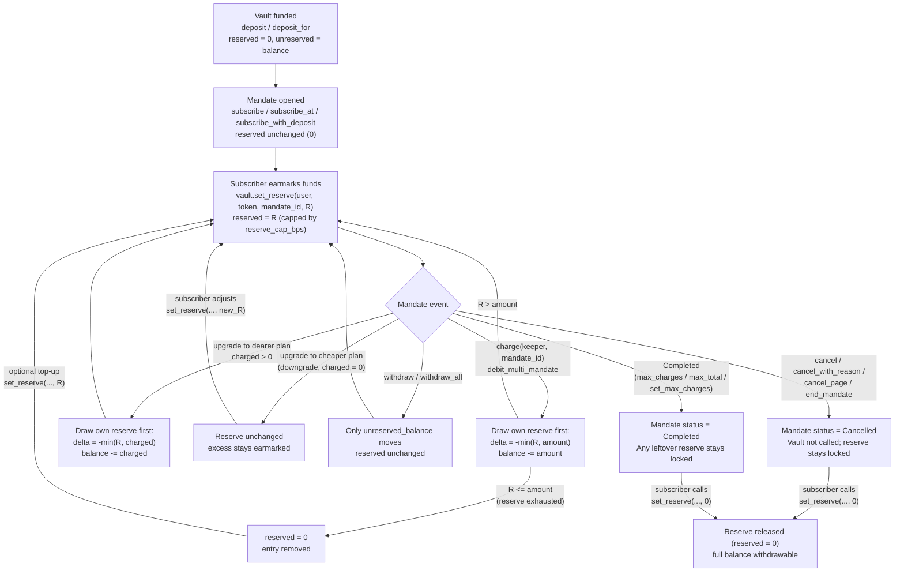

# Vault Reserve Lifecycle

Per-mandate reserves let a subscriber earmark part of their vault balance for a
specific subscription mandate so other mandates or ad-hoc withdrawals cannot
spend it by accident. Reserves live in the `Vault` contract
([`contracts/vault/src/lib.rs`](../contracts/vault/src/lib.rs)) and are
controlled exclusively by the subscriber—the `Subscription` contract never
creates, resizes, or clears a reserve on its own.

## Storage model and invariants

For each `(user, token, mandate_id)` tuple, `Vault` maintains two persistent
storage keys (`PERSIST_BUMP` = 90 days, refreshed on read):

- `DataKey::Reserved(user, token, mandate_id)`: the `i128` amount earmarked for
  `mandate_id`. Entries equal to `0` are removed from storage.
- `DataKey::ReservedTotal(user, token)`: the running sum across all mandates
  for `(user, token)`. Removed when `0`.

The vault enforces these invariants on every state transition:

1. **Sum consistency:** `reserved_total == Σ reserved(user, token, m)` across
   all mandates `m`.
2. **Solvency bound:** `0 <= reserved_total <= balance(user, token)`.
3. **Withdrawable balance:** `unreserved_balance = balance - reserved_total`.
   Only `unreserved_balance` is reachable by `withdraw`, `withdraw_to`,
   `withdraw_all`, `debit`, `debit_split`, or any *other* mandate's debit.
4. **Reserve cap:** `Vault::__constructor` fixes `reserve_cap_bps` (default
   `DEFAULT_RESERVE_CAP_BPS = 9_000`, i.e., 90% of `balance`, keeping at least
   10% free). Growing `reserved_total` above `balance * reserve_cap_bps /
   10_000` fails with `ReserveCapExceeded` (`3018`). Reducing or releasing a
   reserve (`new_total <= total` or `amount == 0`) is **always allowed**, even
   if the cap is `0` or `balance` has fallen below the existing total.
5. **Mandate headroom:** `debit_mandate`, `debit_split_mandate`, and
   `debit_multi_mandate` for `mandate_id` can spend
   `unreserved_balance + reserved(user, token, mandate_id)`, drawing
   `reserved` down first (`from_reserve = own_reserve.min(total)`).

## Lifecycle diagram

## Reserve delta for each state transition

In the table below, `R` is `reserved(user, token, mandate_id)` before the call,
`T` is `reserved_total(user, token)`, and `B` is `balance(user, token)`.

| Operation | Contract | `reserved(mandate_id)` delta | `reserved_total` delta | `unreserved_balance` delta | Events emitted |
|---|---|---|---|---|---|
| `deposit(..., amt)` / `deposit_for(..., amt)` | Vault | `0` | `0` | `+amt` | `Deposit` / `DepositFor` |
| `subscribe` / `subscribe_at` | Subscription | `0` | `0` | `0` | `MandateUpdated`, `Subscribed`, `CommittedRevenueChanged` |
| `subscribe_with_deposit(..., dep, ...)` | Subscription → Vault | `0` | `0` | `+dep` | `Deposit`, `MandateUpdated`, `Subscribed`, `CommittedRevenueChanged` |
| `set_reserve(..., mandate_id, A)` where `A > R` | Vault | `+(A - R)` | `+(A - R)` | `-(A - R)` | `ReserveSet` |
| `set_reserve(..., mandate_id, A)` where `0 < A < R` | Vault | `-(R - A)` | `-(R - A)` | `+(R - A)` | `ReserveSet` |
| `set_reserve(..., mandate_id, 0)` (release) | Vault | `-R` (entry removed) | `-R` | `+R` | `ReserveSet` |
| `emergency_withdraw(subscriber, token)` (admin only) | Vault | `-R` (all entries removed) | `-T` (`0`) | `+T` (full balance withdrawable) | `EmergencyWithdraw` |
| `charge` (`debit_multi_mandate` for `total`) | Subscription → Vault | `-min(R, total)` | `-min(R, total)` | `-(total - min(R, total))` | `Debit` (per non-zero leg), `MandateUpdated`, `Charged` (no `ReserveSet`) |
| `upgrade` (price increase, `charged > 0`) | Subscription → Vault | `-min(R, charged)` | `-min(R, charged)` | `-(charged - min(R, charged))` | `Debit` (per non-zero leg), `MandateUpdated`, `Upgraded`, `CommittedRevenueChanged` |
| `upgrade` (downgrade or `charged == 0`) | Subscription | `0` | `0` | `0` | `MandateUpdated`, `Upgraded`, `CommittedRevenueChanged` |
| `withdraw` / `withdraw_to` / `withdraw_all` (`amt`) | Vault | `0` | `0` | `-amt` | `Withdraw` / `WithdrawTo` (none if `withdraw_all` returns `0`) |
| `debit` / `debit_split` / other mandate `m2` charge (`amt`) | Vault | `0` (`m1` untouched) | `-min(R_m2, amt)` | `-(amt - min(R_m2, amt))` | `Debit` |
| `set_paused` / `pause_until` | Subscription | `0` | `0` | `0` | `MandateUpdated`, `PauseChanged` |
| `propose_mandate_owner` / `accept_mandate_owner` | Subscription | `0` (stays on old subscriber) | `0` | `0` | `MandateTransferred` |
| `cancel` / `cancel_with_reason` / `cancel_page` / `end_mandate` | Subscription | `0` (not auto-released) | `0` | `0` | `MandateUpdated`, `Cancelled` / `MandateEnded`, `CommittedRevenueChanged` |
| Mandate completes via `charge` (`max_charges` / `max_total`) | Subscription → Vault | `-min(R, total)` | `-min(R, total)` | `-(total - min(R, total))` | `Debit`, `MandateUpdated`, `Charged`, `MandateCompleted` |
| Mandate completes via `set_max_charges` | Subscription | `0` (not auto-released) | `0` | `0` | `MandateUpdated`, `MaxChargesChanged`, `MandateCompleted` |

> **Ownership transfer note:** `DataKey::Reserved` is keyed by `(user, token,
> mandate_id)`. When a mandate transfers via `propose_mandate_owner` /
> `accept_mandate_owner`, any reserve held under the previous subscriber's
> address is **not** moved to the new subscriber; the previous subscriber must
> release it with `set_reserve(..., 0)`, and the new subscriber must deposit
> and set their own reserve if desired.

## Expired vs. cancelled mandates

Because `Vault` and `Subscription` are separate contracts ([ADR
0001](adr/0001-vault-separate-from-billing.md)), closing a mandate in
`Subscription` never reaches across to clear `Vault` storage. That keeps
cancellation safe even during a protocol pause or if a dependency fails, and
means `set_reserve` is always the single authority over reserves.

### Cancelled mandates (`cancel`, `cancel_with_reason`, `cancel_page`, `end_mandate`)

- `Subscription` transitions the mandate to `MandateStatus::Cancelled`, frees
  the plan seat, and recomputes committed revenue without calling `Vault`.
- Any existing `Reserved(user, token, mandate_id)` remains intact in `Vault`,
  continuing to subtract from `unreserved_balance` and blocking `withdraw` /
  `withdraw_all` for that amount.
- **How funds are freed:** The subscriber calls `vault.set_reserve(user, token,
  mandate_id, 0)`. This reduces `reserved_total` by `R`, emits `ReserveSet`,
  and makes the entire released amount immediately withdrawable.

### Completed mandates (`MandateStatus::Completed`)

A mandate reaches `MandateStatus::Completed` (often referred to as reaching its
natural end or expiring its charge/spend cap) in two ways:

1. **Via the final `charge` (`charges_made == max_charges` or `total_spent >= max_total`):**
   `charge` debits `mandate.amount` through `debit_multi_mandate`, which draws
   `min(R, mandate.amount)` from the mandate's reserve first.
   - If the subscriber reserved exactly one period (`R == mandate.amount`), the
     final charge consumes the entire reserve and automatically removes
     `Reserved(user, token, mandate_id)` (setting it to `0`).
   - If the subscriber over-reserved (`R > mandate.amount`), the remainder
     `R - mandate.amount` stays earmarked in `Vault` until the subscriber calls
     `set_reserve(..., mandate_id, 0)`.
2. **Via `set_max_charges` lowered to `charges_made`:**
   No vault debit occurs, so `R` remains untouched in `Vault` until the
   subscriber calls `set_reserve(..., mandate_id, 0)`.

### On-chain TTL expiry of a mandate

- If a `Mandate` entry in `Subscription` is not accessed or extended within its
  90-day Soroban persistent TTL window and expires from live ledger state,
  `Vault` is unaffected: `DataKey::Reserved(user, token, mandate_id)` lives in
  `Vault`'s own persistent storage with its own 90-day TTL.
- Because `Vault` does not require the `mandate_id` to exist in `Subscription`
  when releasing a reserve, the subscriber can always call
  `vault.set_reserve(user, token, mandate_id, 0)` to reclaim the reserve and
  withdraw their funds.
